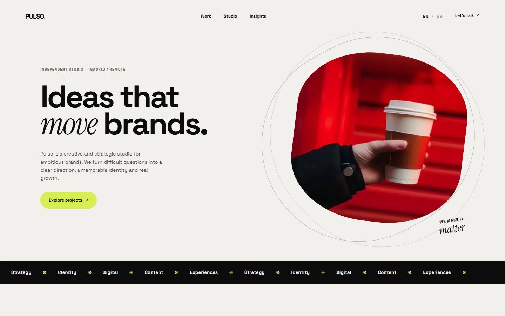

# Pulso — Creative & Strategy Studio Landing

Ideas that move brands. A bilingual landing page for an independent creative and strategic studio, built around big editorial type, a lime-and-cream palette and a single memorable promise: signal over noise.



## Overview

Pulso is a one-page studio site with seven sections: hero, service marquee, manifesto, selected work, insights and a full-bleed contact closer. The layout keeps the bold typographic rhythm of the reference — oversized headlines with serif italic accents, a rotated organic image mask and a dark rounded footer — rebuilt from scratch on a typed design system.

Both locales are statically generated, every image and font is self-hosted, and social cards are produced at request time from the same dictionaries as the page.

## Key Features

- **Bilingual routing (`en` / `es`):** Typed dictionaries, `/[locale]` App Router segments, `Accept-Language` negotiation and a `pulso.locale` cookie that keeps the visitor's choice.
- **Consistent metadata:** Canonical URLs, `hreflang` alternates with `x-default`, per-locale OpenGraph tags and a multilingual sitemap.
- **Motion with no library:** An infinite CSS marquee and a staggered entrance animation for the hero. Both stop under `prefers-reduced-motion`.
- **Self-hosted imagery:** Four studio photographs generated for this project, served through `next/image` — no stock libraries, no remote media.
- **Self-hosted typography:** Space Grotesk and Instrument Serif are bundled at build time via `next/font/google`; the browser never contacts a font CDN.
- **Accessible navigation:** The mobile menu is keyboard operable, closes on `Escape`, exposes `aria-expanded`/`aria-controls`, and marks the active locale with `aria-current`.
- **Localised 404:** A locale catch-all route routes unknown paths into the styled not-found page instead of the Next.js default.

## Tech Stack

- **Framework:** Next.js 16.4.3 (App Router, Turbopack)
- **Library:** React 19.2.4
- **Language:** TypeScript 5.7.3 (strict)
- **Styling:** Tailwind CSS 4.3.3 with CSS-first `@theme` tokens
- **Icons:** Lucide React
- **Analytics:** `@vercel/analytics`
- **Package Manager:** pnpm 11.17

## Architecture

```
pulso-studio/
├── docs/
│   ├── provenance.md          # Compliance ledger and transformation history
│   └── screenshot.webp        # Visual preview artifact
├── public/
│   └── images/                # Hero and three project photographs
├── src/
│   ├── app/
│   │   ├── [locale]/
│   │   │   ├── [...rest]/page.tsx   # Catch-all that renders the 404
│   │   │   ├── layout.tsx     # Locale shell, font variables, analytics
│   │   │   ├── not-found.tsx  # Styled 404
│   │   │   ├── opengraph-image.tsx   # 1200x630 social card
│   │   │   └── page.tsx       # Composed landing route
│   │   ├── globals.css        # Design tokens, keyframes and base layers
│   │   ├── icon.svg           # Waveform brand mark and favicon
│   │   ├── robots.ts
│   │   └── sitemap.ts
│   ├── components/
│   │   ├── arrow.tsx          # Arrow and asterisk glyphs
│   │   ├── footer.tsx
│   │   ├── hero.tsx
│   │   ├── insights.tsx
│   │   ├── locale-switcher.tsx
│   │   ├── manifesto.tsx
│   │   ├── navigation.tsx
│   │   ├── service-marquee.tsx
│   │   └── work.tsx
│   ├── config/site.ts         # Domain and locale configuration
│   ├── i18n/
│   │   ├── config.ts          # Locale list and cookie name
│   │   ├── dictionaries/      # Typed English and Spanish copy
│   │   └── get-dictionary.ts
│   ├── lib/seo.ts             # Canonical and hreflang metadata builder
│   └── proxy.ts               # Locale detection and persistence
├── eslint.config.mjs
├── next.config.ts
├── package.json
└── tsconfig.json
```

## Getting Started

### Prerequisites

- Node.js >= 20.9.0
- pnpm >= 10.0.0

### Installation

```bash
git clone https://github.com/JORDANROBERTO74/pulso-studio.git
cd pulso-studio
pnpm install
```

### Development

```bash
pnpm dev
```

Visit [http://localhost:3000](http://localhost:3000). The root redirects to `/en` or `/es` based on the request.

### Quality Checks

```bash
pnpm typecheck   # TypeScript, no emit
pnpm lint        # ESLint flat config
pnpm build       # Production build
```

## Deployment

The site is deployed on Vercel with the default Next.js preset. Import the repository, or run:

```bash
vercel deploy --prod
```

Set `NEXT_PUBLIC_SITE_URL` when serving from a custom domain; otherwise the canonical URL falls back to `https://pulsostudio-madrid.vercel.app`.

## Performance & SEO

- `/en` and `/es` are statically generated; the locale redirect is handled by edge middleware.
- Every photograph is served through `next/image` with responsive `srcset` and AVIF/WebP negotiation.
- `sitemap.xml` and `robots.txt` are derived from the locale configuration.
- OpenGraph and Twitter cards are generated from the same dictionaries as the page, so titles never drift.
- Fonts are preloaded by `next/font` with automatic size-adjust metrics, so there is no layout shift.

## Accessibility

- Semantic landmarks (`header`, `nav`, `main`, `section`, `footer`) and a single `h1` per locale.
- Mobile menu: `aria-expanded`, `aria-controls`, `Escape` to close, focus-visible styles on every control.
- Decorative marquee content is hidden from assistive technology; the section exposes a single label.
- Colour pairs (ink on cream, cream on ink) exceed WCAG AA; lime is only used behind ink text.

## Compliance & Licensing

This project was rebuilt under clean-room principles:

- No proprietary trademarks, third-party logos, stock photography or celebrity likenesses.
- All copy and the Spanish translation are original to this project.
- The four photographs were generated for this build and ship with the repository.
- The full audit trail lives in [`docs/provenance.md`](docs/provenance.md).

## License

This project is licensed under the MIT License — see the [LICENSE](LICENSE) file for details.
